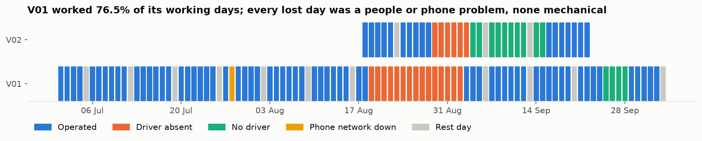
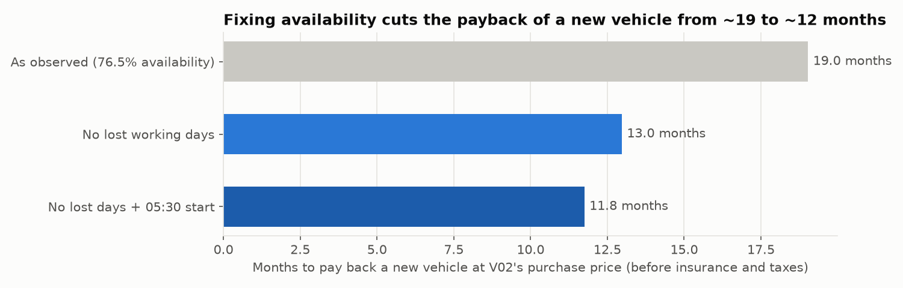

# Fleet Operations Analytics — Vemov (Luanda)

> Is each vehicle paying for itself, where is money lost, and should the company buy a third vehicle now?

Operational analytics for **Vemov**, the small ride-hailing fleet I own and run in Luanda, Angola: 2 vehicles, 3 drivers, Yango and Heetch. The data is **real, anonymized and money-indexed**.



## Key findings
| # | Finding | Number |
|---|---|---|
| 1 | Lost working days were the biggest leak | V01 worked **76.5%** of its working days · the lost revenue equals ~**31%** of what it earned. All lost days were people or phone problems, none mechanical |
| 2 | Maintenance costs almost as much as fuel | maintenance ≈ **78%** of fuel cost per km · margin **59%** before insurance |
| 3 | Kilometres without revenue | ~**1,700 km** in two intervals: a control gap that GPS reconciliation should close |
| 4 | The best hour is missed | Trips at 06:00 pay **+28%**; the average first trip is at 06:25 instead of 05:30 |
| 5 | Payback depends on availability | A new vehicle pays back in ~**19 months** today, ~**12** with full availability |

**Decision:** fix availability first (standby driver, second SIM, GPS reconciliation), then buy the third vehicle. See the [decision memo](docs/decision_memo.md).



## Why this matters beyond ride-hailing
These are the same questions asked of any operated asset, whether a fuel-distribution truck, an offshore supply vessel or a producing well:
- **Availability** and the cost of downtime by cause.
- **Cost per unit** of activity.
- **Reconciling** what the meter says with what was billed.
- **Payback** on capital.

My [Volve field project](https://github.com/agmiguel018/volve-production-performance) applies the same logic to oil wells.

## Data
- **Source:** the company's daily operations workbooks, built from the drivers' apps (trips and net earnings), fuel receipts, weekly odometer readings, maintenance invoices and salary records.
- **Period:** V01 from 1 Jul to 4 Oct 2026 (96 days, 1,058 trips); V02 from 17 Aug to 22 Sep 2026 (36 days, 186 trips).
- **Anonymization** ([`src/extract_anonymized.py`](src/extract_anonymized.py)):
  - Vehicles, drivers and platforms become IDs.
  - **No** names, plates, phone numbers, pick-up locations, fuel stations or personal notes are published.
  - Notes become neutral stop categories (`driver_absence`, `no_driver`, `network_outage`, `rest_day`).
- **Money-indexed:** every amount is real kwanza (AOA) × one confidential factor. Percentages, ratios, km, trips, hours and payback months are exact; absolute amounts are not. Fuel litres are not published, because with the public fuel price they would reveal the factor.
- **Reconciled:** before indexing, trips and net revenue are checked against each source workbook's TOTAL row ([`notebooks/01_data.ipynb`](notebooks/01_data.ipynb)).

## Approach
Private workbooks → anonymized, money-indexed tables (Python) → KPIs (SQL, DuckDB) → analysis and scenarios (Python) → decision memo

| KPI | Definition |
|---|---|
| Availability | operated days ÷ working days (calendar days minus contractual rest days) |
| Downtime cost | idle working days × the vehicle's average net revenue per operated day |
| Cost and margin per km | each cost line ÷ km between odometer readings |
| Km without revenue | km between readings − operated days × typical km per day |
| Payback | vehicle price ÷ monthly margin (before insurance and taxes); unaffected by the money index |

## Tools
Python (pandas, matplotlib) · SQL (DuckDB) · Excel (source records)

## Repository structure
```
data/anonymized/   published tables: daily, trips, costs, odometer, vehicles, drivers
src/               anonymization script (reads the private workbooks, never stores them)
sql/kpis.sql       KPI queries
notebooks/         01_data (coverage, reconciliation, limits) → 02_analysis
docs/              decision memo
images/            charts used here
```

## How to reproduce
```bash
pip install -r requirements.txt
```
Then run `notebooks/01_data.ipynb` and `notebooks/02_analysis.ipynb`. They read only `data/anonymized/`.

## About me
**Aguinaldo Miguel** — Automation & Control Engineer | Data Analytics for Oil & Gas Operations and Supply Chain · Luanda, Angola · [LinkedIn](https://linkedin.com/in/agmiguel)

---
*Code: MIT License. Data: © Vemov (AG Miguel – Prestação de Serviços), published anonymized and money-indexed for portfolio purposes.*
